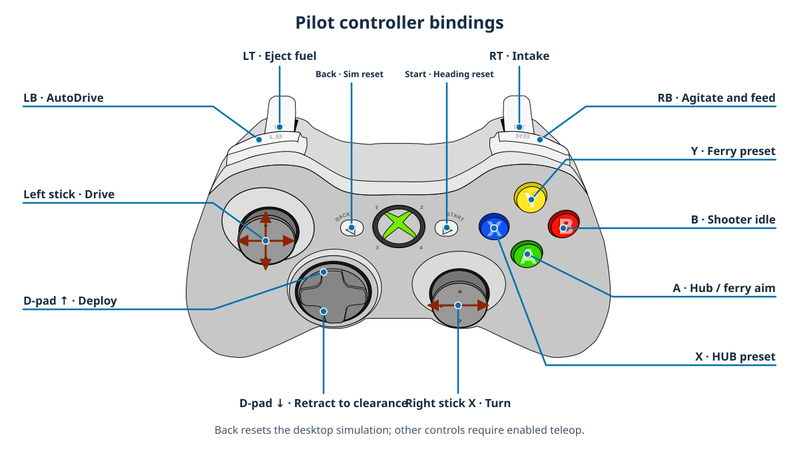
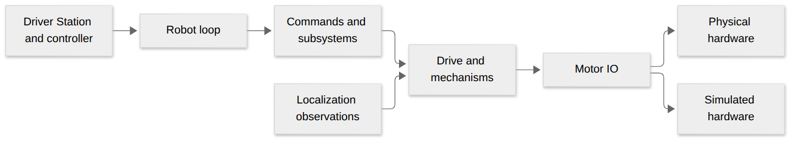

# 2026 REBUILT robot: C++

This is MECO Robotics' 2026 robot code. It runs on the roboRIO and in a desktop simulator. Start here if you're new to the project.

## Get started

1. Install **WPILib 2026.2.1** with the C++ tools.
2. Open this folder in WPILib VS Code.
3. Build and start the simulator:

   ```sh
   ./gradlew build --max-workers=2
   ./gradlew simulateNative
   ```

   If Gradle can't find Java, set `JAVA_HOME` to the WPILib 2026 JDK first.
4. Connect a controller in SimGUI. See [practice matches](docs/practice-mode.md) to run a match or [AutoDrive](docs/autodrive-simulation.md) to try autonomous driving.

The pinned dependencies include [MecoBase 2026.2.12](vendordeps/MecoBase.json) and [MecoSimulation 2026.0.18](vendordeps/MecoSimulation.json). Building and simulating do **not** prove that a physical robot is safe or calibrated. Deploying with `./gradlew deploy` writes to team 8324's roboRIO.

## Pilot controls

These controls work in enabled teleop. Hold actions run while you hold the control.



Controller artwork adapted from [Xbox Controller.svg](https://commons.wikimedia.org/wiki/File:Xbox_Controller.svg) by Jishenaz, CC0. Your controller may look different; the control names below still apply.

| Control | Action |
| --- | --- |
| Left stick / right stick X | Drive / turn |
| Left bumper | Run AutoDrive while held |
| Right trigger / left trigger | Intake / eject fuel while held |
| Right bumper | Agitate and feed while held; rumble indicates shooter readiness |
| A | Assist aiming while driving: hub in the alliance zone; straight toward the alliance zone for a ferry shot outside it |
| X / Y / B | Select hub / ferry / shooter idle |
| POV up / down | Deploy / retract the intake to its clearance-safe position while held |
| Start | Reset the driver heading reference (the gyro and field pose are unchanged) |
| Back / View | Reset the simulation scene (desktop only) |

Hold **A** to control rotation, hood position, and flywheel speed while keeping manual translation. In the alliance zone, aim assist targets the hub. Outside the zone, it points the shooter straight toward the friendly driver station and calculates a ferry shot to a point 0.90 m inside the alliance line. The calculation updates as the robot moves. On the physical robot, the shooter faces the rear, so the robot's front faces away from the driver station during this ferry shot.

A does not feed fuel; use **right bumper** to feed. The straight ferry path can cross field structures, and the driver assist does not block feeding based on the ferry path. Shot range and landing position require physical calibration.

X runs the hub preset until another command takes the hood or shooter; interruption stops both. Y sets the ferry preset once and leaves its targets active until another action changes them. Holding A interrupts the hub preset, and releasing A stops the hood and shooter. Select a preset again if needed.

## Where should I look?

New to the code? Start with the [student editing guide](docs/student-editing-guide.md) to find the files for autos, mechanisms, and constants.

| I want to… | Start here |
| --- | --- |
| Understand buttons and autonomous choices | [RobotContainer.cpp](src/main/cpp/RobotContainer.cpp) and [RobotAutos.cpp](src/main/cpp/season/auto/RobotAutos.cpp) |
| Understand robot modes and the main loop | [Robot.cpp](src/main/cpp/Robot.cpp) |
| Find mechanism motor settings and command interfaces | [MechanismConfig.h](src/main/include/season/mechanisms/MechanismConfig.h) and [season commands](src/main/cpp/season/mechanisms/SeasonCommands.cpp) |
| Understand shooting and targeting | [Shooting.h](src/main/include/season/shooting/Shooting.h) and [Shooting.cpp](src/main/cpp/season/shooting/Shooting.cpp) |
| Try AutoDrive | [AutoDrive guide](docs/autodrive-simulation.md) |
| Configure control/CAN/NT rates | [control timing](docs/control-timing.md) |
| Run USB gamepad over NT | [controller setup](docs/nt-gamepad.md) |
| Understand the simulated field and fuel | [simulation field](docs/simulation-field.md) |
| Find a guide | [documentation index](docs/README.md) |

Season code is grouped by purpose under `src/main/cpp/season` and `src/main/include/season`: `drive` contains AutoDrive, offensive planning, and scoring-position selection; `shooting` contains shot calculations; `mechanisms` contains mechanism settings and commands; `RobotGeometry.h` contains robot-wide dimensions and pose helpers; `simulation` contains the desktop field, runtime adapter, and fuel model; and `diagnostics` contains system-check setup. All headers live under `src/main/include`; `season/detail` contains implementation-only declarations, while public interfaces and configuration are grouped by subsystem. Non-template implementations live in the matching `.cpp` files where practical.

Robot and simulation settings are grouped by subsystem. Mechanism hardware is in `MechanismConfig.h`, behavior settings are in `MechanismBehaviorConfig.h`, and command interfaces are in `Mechanisms.h`; robot dimensions and pose helpers are in `RobotGeometry.h`; drivetrain hardware is in `DriveConfig.h` and driver aiming settings are in `DriveBehaviorConfig.h`; QuestNav and AprilTag camera mounts are in `VisionConfig.h`; object-perception camera settings are in `PerceptionConfig.h`; and loop timing is in `RobotControlConfig.h`. AutoDrive and offensive planning settings live at the top of their API headers, and desktop model assumptions are in `SimulationConfig.h`, `MechanismSimulationConfig.h`, and `DriveSimulationConfig.cpp`.

## How the pieces connect



[Diagram source](docs/visuals/mermaid/robot-overview.mmd)

- **MecoBase** provides shared robot code such as drive, motor IO, and commands.
- **MecoSimulation** provides reusable desktop physics, simulated sensors, and motor IO integration. Season code supplies REBUILT-specific game-piece load torque.
- **This project** supplies the 2026 robot's hardware settings, controls, and game behavior. See the [vendordep guides](docs/README.md#vendordep-documentation).
