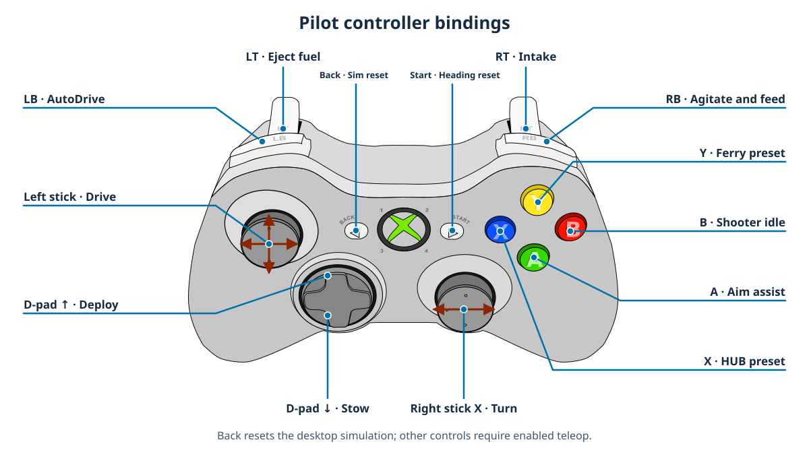
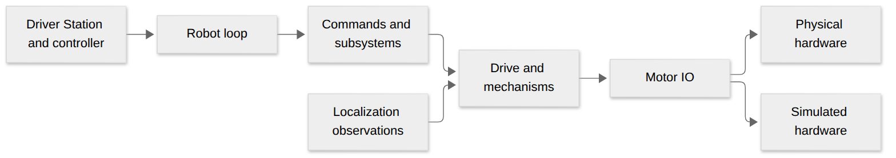

# 2026 REBUILT robot: C++

This is MECO Robotics' 2026 robot code. It runs on the roboRIO and in a desktop simulator. Start here if you're new to the project.

## Get started

1. Install **WPILib 2026.2.1** with the C++ tools.
2. Open this folder in WPILib VS Code.
3. Build and start the simulator:

   ```sh
   ./gradlew build --max-workers=2
   ./gradlew simulateNative
   ```

   If Gradle can't find Java, set `JAVA_HOME` to the WPILib 2026 JDK first.
4. Connect a controller in SimGUI. See [practice matches](docs/practice-mode.md) to run a match or [AutoDrive](docs/autodrive-simulation.md) to try autonomous driving.

The pinned dependencies include [MecoBase 2026.2.10](vendordeps/MecoBase.json) and [MecoSimulation 2026.0.16](vendordeps/MecoSimulation.json). Building and simulating do **not** prove that a physical robot is safe or calibrated. Deploying with `./gradlew deploy` writes to team 8324's roboRIO.

## Pilot controls

These controls work in enabled teleop. Hold actions run while you hold the control; presets stay selected until changed.



Controller artwork adapted from [Xbox Controller.svg](https://commons.wikimedia.org/wiki/File:Xbox_Controller.svg) by Jishenaz, CC0. Your controller may look different; the control names below still apply.

| Control | Action |
| --- | --- |
| Left stick / right stick X | Drive / turn |
| Left bumper | Run AutoDrive while held |
| Right trigger / left trigger | Intake / eject fuel while held |
| Right bumper | Agitate and feed while held; rumble indicates shooter readiness |
| A | Assist aiming while driving: hub in the alliance zone, ferry outside it |
| X / Y / B | Select hub / ferry / shooter idle |
| POV up / down | Deploy / stow the intake while held |
| Start | Reset the driver heading reference (the gyro and field pose are unchanged) |
| Back / View | Reset the simulation scene (desktop only) |

## Where should I look?

| I want to… | Start here |
| --- | --- |
| Understand buttons and autonomous choices | [RobotContainer.cpp](src/main/cpp/RobotContainer.cpp) |
| Understand robot modes and the main loop | [Robot.cpp](src/main/cpp/Robot.cpp) |
| Find motor settings and command interfaces | [Mechanisms.h](src/main/include/season/Mechanisms.h) and [season commands](src/main/cpp/season/SeasonCommands.cpp) |
| Understand shooting and targeting | [Shooting.h](src/main/include/season/Shooting.h) and [Shooting.cpp](src/main/cpp/season/Shooting.cpp) |
| Try AutoDrive | [AutoDrive guide](docs/autodrive-simulation.md) |
| Understand the simulated field and fuel | [simulation field](docs/simulation-field.md) |
| Find a guide | [documentation index](docs/README.md) |

## How the pieces connect



[Diagram source](docs/visuals/mermaid/robot-overview.mmd)

- **MecoBase** provides shared robot code such as drive, motor IO, and commands.
- **MecoSimulation** provides the desktop physics and simulated sensors.
- **This project** supplies the 2026 robot's hardware settings, controls, and game behavior. See the [vendordep guides](docs/README.md#vendordep-documentation).
