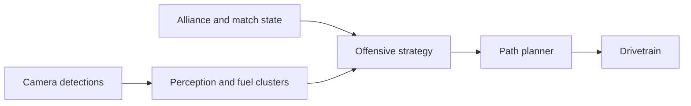

# AutoDrive

AutoDrive is robot code that chooses a target and asks the drivetrain to navigate there. It runs on the robot and in desktop simulation. The planner is supplied by MecoBase; this project supplies season targets and behavior.

## Try it

- In enabled **teleop**, hold the pilot's **left bumper (LB)**. Release it to cancel.
- Set `AutoDrive/OffenseEnabled` in SmartDashboard or Elastic to choose what LB does. Desktop simulation starts with it enabled; the robot starts with it disabled.
- In autonomous, select **AutoDrive target** or **AutoDrive offensive** in `Auto Choices`.
- For a complete simulated match, follow the [practice match guide](practice-mode.md).

| Mode | What it does |
| --- | --- |
| Target drive | Drives to `AutoDrive/TargetX`, `TargetY`, and `TargetHeading`; defaults are 3 m, 0.65 m, and 0 rad. These use the blue-origin field frame on both alliances. Release and press LB again to sample a new fixed target. |
| Follow fuel | With `AutoDrive/FollowFuel` enabled, tracks the nearest fresh fuel observation. The intake is still controlled separately. |
| Offensive | Uses match state and observed fuel to collect, return, shoot, or ferry. This mode also controls mechanisms. |

## What offense needs

- A known alliance and HUB state. If either is unknown, it waits; check `/Match/HubKnown` and `AutoDrive/OffensePhase`.
- Fresh camera observations. Hardware expects Jetson detections on `/Perception/front/detections` and `/Perception/rear/detections`.
- Accurate localization and a suitable navgrid. The code cannot determine whether the physical field or robot is safe.
- A practice match can provide simulated match time and game data. It is not required for ordinary fixed-target driving.

The robot has no carried-fuel sensor. Offense estimates pickups from detections near the intake, so it can be wrong or attempt an empty shot. Its ferry and shot readiness checks can also make it wait.

## Limits and troubleshooting

- `AutoDrive/Status`, `AutoDrive/Active`, and `AutoDrive/OffensePhase` show what is happening. Collection goal coordinates are published as `AutoDrive/CollectionGoalX` and `AutoDrive/CollectionGoalY`.
- The experimental footprint options are separate from the normal PathPlanner route. See the [detailed record](reference/autodrive-simulation.md) before enabling them.
- Desktop matches have collected and scored, but one full run spent about 20 seconds stationary in collection with zero drive requests. That issue remains unresolved in the recorded run. See [the trace](../artifacts/offensive-target-lock-full-match.json.gz).
- Simulated results are not physical driving or camera validation.

## Read the code

- [Bindings and chooser](../src/main/cpp/RobotContainer.cpp)
- [AutoDrive target and perception](../src/main/cpp/season/AutoDrive.cpp) and [interface](../src/main/include/season/AutoDrive.h)
- [Offensive command](../src/main/cpp/season/OffensiveAutoDrive.cpp) and [decision helpers](../src/main/include/season/OffensiveAutoDrive.h)
- [Navgrid](../src/main/deploy/pathplanner/navgrid.json) and [match test](../scripts/autodrive_offensive_match.py)

For configurations, test commands, and historical results, see the [detailed AutoDrive record](reference/autodrive-simulation.md).
