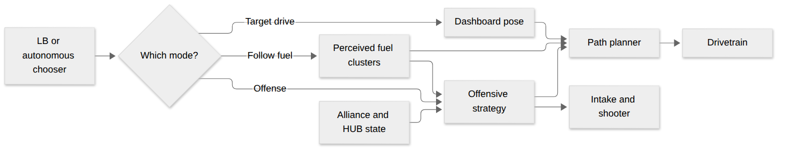
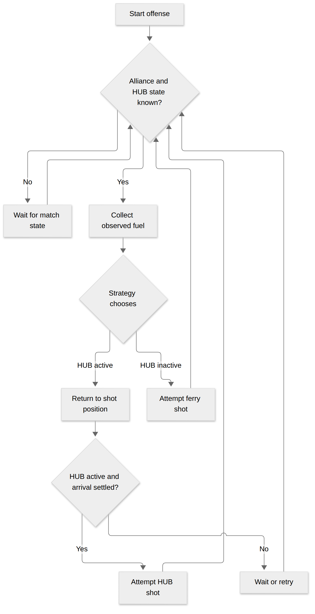

# AutoDrive

The reusable planner and command contracts are documented in [MecoBase AutoDrive](https://github.com/MECO-Robotics/MecoBase-cpp/blob/main/docs/autodrive.md).

AutoDrive is robot code that chooses a target and asks the drivetrain to navigate there. It runs on the robot and in desktop simulation. The planner is supplied by MecoBase; this project supplies season targets and behavior.

Select the diagram to view it full size.

[Diagram source](visuals/mermaid/autodrive-modes.mmd)

## Try it

- In enabled **teleop**, hold the pilot's **left bumper (LB)**. Release it to cancel.
- Set `AutoDrive/OffenseEnabled` in SmartDashboard or Elastic to choose what LB does. Desktop simulation starts with it enabled; the robot starts with it disabled.
- In autonomous, select **AutoDrive target** or **AutoDrive offensive** in `Auto Choices`.
- For a complete simulated match, follow the [practice match guide](practice-mode.md).

| Mode | What it does |
| --- | --- |
| Target drive | Drives to `AutoDrive/TargetX`, `TargetY`, and `TargetHeading`; defaults are 3 m, 0.65 m, and 0 rad. These use the blue-origin field frame on both alliances. Release and press LB again to sample a new fixed target. |
| Follow fuel | With `AutoDrive/FollowFuel` enabled, tracks the nearest fresh fuel observation. The intake is still controlled separately. |
| Offensive | Uses match state and observed fuel to collect, return, shoot, or ferry. This mode also controls mechanisms. |

## Offensive cycle

[Diagram source](visuals/mermaid/offensive-cycle.mmd)

This is a simplified cycle. The strategy can also continue collecting, and a shot still needs to pass readiness checks. Release LB to cancel in teleop.

For a HUB shot, offense chooses the cheapest reachable legal shooting cell using distance on the deployed static navgrid. For returns from midfield it first attempts to cross through the nearer trench, then selects a shooting cell. If already in a suitable alliance-zone position, it aims from there even when its current navgrid cell is blocked. Shooting positions exclude the modeled bump plates plus a conservative robot-footprint margin, and require room to rotate clear of the depot rails; pathfinding may still cross bumps. If the robot is at the depot when it needs to shoot, it first drives toward the field to clear the rail before selecting a shooting position. If its pose overlaps the conservative bump-clearance region, it first attempts a straight retreat before selecting a scoring node. Arrival, an active HUB, and shooter readiness are required before feeding. The grid cost does not account for dynamic obstacles, and the field and robot dimensions are not physical calibration.

While returning for a HUB shot, offense warms the hood and flywheel using the current shot solution. Feeding remains gated by the coordinated shot command after arrival.

During collection, the robot retains the last observed pickup through camera occlusion, favors nearby fuel while the HUB is active and fuel along its motion while inactive, and selects another target after passing it, reaching a through-point clipped at the field edge, or losing progress. For a blocked through-point, it searches backward along the pickup corridor for a free grid cell and skips the pickup if none is available; the pathfinder still checks the route. If its estimated pose overlaps a bump, collection requests a retreat toward the nearest side. A focused desktop probe remained high-centered despite this request and bounded direct-drive attempts; ramp recovery remains unresolved. In the final 100 probe samples, bumper-backing contact was present throughout while average reported wheel normal loads were approximately 0, 12, 69, and 0 N. These are simulation diagnostics, not physical measurements. Trips from the alliance side toward midfield use staged trench waypoints. The retained position is an estimate and can be stale if the fuel moves. The Moses PathPlanner routes use trench waypoints for their crossings rather than specifying diagonal bump crossings. A desktop match handed off to teleop clear of the bump, but its sampled autonomous trace still showed brief elevation near the bump, so reliable clearance is unverified. Collection can follow a field-relative spline through a bounded chain of visible clusters, with a HUB or ferry-side approach when the chain covers the remaining estimated load. Its follower limits requested translation to the configured AutoDrive maximum and checks the sampled curve against the static navgrid, bump clearance, and depot clearance; if the chain cannot be validated, it falls back to the moving-target pathfinder. It replans after each chain and cannot account for unobserved or moving obstacles. Drivetrain tracking and pickup estimates need physical validation.

A temporary absence of eligible observations does not by itself end collection. Capacity, the bounded collection attempt, and shift timing still trigger a return or ferry.

The collection decision uses `AutoDrive/EstimatedCapacity`; in desktop simulation a zero preference falls back to the fuel model's configured capacity. Pickup counts remain estimates and can differ from the actual load.

For diagnostics, `/SmartDashboard/FieldSimulation/StoredFuelCount` is the simulator's actual hopper count. `/SmartDashboard/AutoDrive/EstimatedFuel` is the observation-based estimate used by offense. AutoDrive does not consume the simulated count, and the physical robot has no corresponding hopper-count sensor.

The desktop motor model applies estimated, noisy fuel-contact torque to the conveyor, both indexers and the shooter; its coefficients are not hardware-calibrated. Motor currents are published under `/SmartDashboard/FieldSimulation/` as `ShooterCurrentAmps`, `ConveyorCurrentAmps`, `BottomIndexerCurrentAmps`, and `TopIndexerCurrentAmps`. During offensive feeding, sustained quiet shooter current and roller-current fluctuations can end a volley early; `AutoDrive/CurrentIndicatesEmpty` reports that inference. The `AutoDrive/EmptyShooterCurrentAmps` and `AutoDrive/EmptyRollerNoiseAmps` preferences configure the detector. Their real-robot defaults are zero, which disables current-based completion until calibrated; the configured capacity/rate time remains the fallback.

Near the end of an active HUB shift, offense compares the remaining time with the configured full-hopper feed duration plus estimated travel to a shooting position and onward to the neutral-side trench. If that work will not fit, it prepares for the inactive shift instead of starting a new HUB attempt. Travel time uses the AutoDrive speed limit and is an estimate, not an arrival guarantee.

When already in its alliance zone with estimated fuel, offense can score instead of chasing a neutral-zone pickup if the estimated trip would leave insufficient time to return, feed, and reposition before the shift change. Before endgame, when outside the alliance zone, a previously observed completed return time can prevent starting another return that would not leave time for setup, feed, and repositioning; `AutoDrive/ObservedReturnSeconds` shows that observation. For a return triggered by a closing scoring window, offense compares the estimated hopper fraction with the fraction of the remaining window needed to travel and feed. For a ferry triggered by a closing window, it compares the estimated hopper fraction with the fraction needed to feed. These scheduling heuristics use an uncertain pickup estimate, not a measurement of fuel possession.

Near the end of the match, offense can end collection based on configured feed duration, estimated return travel, the most recently observed HUB setup time, and the most recently observed delay between requesting feed and transport activity. HUB setup time is published as `AutoDrive/ObservedHubSetupSeconds`. The HUB delay is exposed as `AutoDrive/ObservedTransportLatencySeconds`; ferry delay is recorded separately as `AutoDrive/ObservedFerryTransportLatencySeconds` so it does not overwrite the HUB estimate. Physical-robot feedback currently reports the request rather than measured roller motion, so these estimates need hardware validation.

Near the end of an inactive shift, the full-hopper duration, estimated trench travel, and observed HUB setup time trigger preparation for activation. With an estimated load, the robot stops collection, attempts the trench return, aims at a legal HUB position, and warms the shooter while waiting. If a ferry attempt no longer leaves time for a replacement load before transport starts, it is canceled so the robot can stage; an active volley remains subject to the shift change and other safety conditions.

## What offense needs

- A known alliance and HUB state. If either is unknown, it waits; check `/Match/HubKnown` and `AutoDrive/OffensePhase`.
- Fresh camera observations. Hardware expects Jetson detections on `/Perception/front/detections` and `/Perception/rear/detections`.
- Accurate localization and a suitable navgrid. The code cannot determine whether the physical field or robot is safe.
- A practice match can provide simulated match time and game data. It is not required for ordinary fixed-target driving.

During offensive collection, pickup observations update every scheduler cycle rather than only when the path follower requests a target. For an interrupted offensive volley, the estimate subtracts fuel based on active transport time and the configured capacity and rate; it cannot detect a jam or measure the actual amount fed. The robot has no carried-fuel sensor. The PathPlanner `SpinIntake` action and offense share a pickup estimate, so observed autonomous pickups can carry into teleop. A configured full autonomous feed clears that estimate; interrupted feeds preserve it. Offense retains nearby lost detections briefly and estimates pickups as the intake passes their last observed positions, so occlusion or moved fuel can make it wrong or cause an empty shot. Its ferry and shot readiness checks can also make it wait.

During offensive HUB and ferry shots, AutoDrive aims the drivetrain and shooter, runs the intake, and retracts the rack while the shot is ready and feeding. If readiness is lost, feeding stops and the rack returns to the deployed position. `Shooter/Agitating` indicates when this shot agitation is active.

In desktop simulation, `Shooter/Feeding` means the shot is requesting feed; `Shooter/TransportActive` means the simulated transport voltages and roller velocities are in the feed directions. Offensive feed time starts when the simulated transport is active, so its current-limited reversal does not count as completed feeding. A ferry canceled before transport starts retains the commanded reversal time as a lower bound for later ferry decisions; it is not a guarantee of the full reversal time. On the physical robot, transport activity still follows the feed request and does not measure roller direction. The active feed window is the configured `AutoDrive/EstimatedCapacity` divided by `AutoDrive/FeedBallsPerSecond`, sampled at the start of each shot, with no extra time. In desktop simulation, zero-valued preferences use the fuel model's configured capacity and nominal burst rate. On the physical robot, both preferences must be positive; invalid values prevent offensive feeding and set `AutoDrive/FeedConfigurationValid` false. `AutoDrive/FeedDurationSeconds` shows the calculated duration. Transport activity does not measure whether any fuel is present. Desktop collection also requires the simulated intake and conveyor to be rotating in the collection direction. The intake, conveyor, and indexer rollers use an estimated 0.0002 kg m² output inertia for rapid reversal; this value has not been measured from the robot.

The PathPlanner `FeedRollers`, `CoordinatedHubShot`, and `AimedHubShot` markers use the same configured feed duration. `AimedHubShot` owns the drivetrain to maintain aim and must not run alongside a path; Moses 3 Cycle uses it in its stationary shot steps. The shot has a bounded setup and transport-reversal window and finishes when its configured feed completes or autonomous is interrupted. Other autos may use a shorter deadline or race that interrupts a shot before its configured duration finishes. Physical autonomous shots also require the two preferences to be configured.

During an inactive HUB shift, offense estimates replacement-load time from observed pickups. It ferries only when the known time until activation exceeds the estimated ferry feed and reversal, replacement load, return travel, and HUB setup time. If those estimates are unavailable or the cycle does not fit, a full estimated load is kept and the robot stages at a HUB shooting position; a partial load continues collecting until it is time to stage. `AutoDrive/EstimatedRefillSeconds`, `AutoDrive/FerryCycleSeconds`, and `AutoDrive/FerryCycleFeasible` expose the estimates. Pickup counts are imperfect, so this is not a guarantee of replacement or arrival. The ferry still requires a safe shot solution, readiness, and the entire robot to be clear of the bump.
If its current location cannot produce a valid ferry solution, offense first attempts to drive to a suitable neutral-side trench lane. When its estimated pose overlaps a bump, that reposition first requests a straight retreat toward the neutral side. While aiming and feeding it can translate slowly toward the nearest neutral-side trench approach with a velocity-compensated trajectory. If a moving attempt has not started feeding after five seconds, it holds position for the rest of that attempt to help the shot settle. It refuses to feed if the predicted landing or field clearance is unsafe. The moving-shot model and physical shooter remain uncalibrated.

## Limits and troubleshooting

- `AutoDrive/Status`, `AutoDrive/Active`, and `AutoDrive/OffensePhase` show what is happening. `AutoDrive/CollectionPlan` indicates `spline` or `pathfinder`, and `AutoDrive/CollectionChainWaypoints` shows the planned waypoint count. Pathfinder goal coordinates are published as `AutoDrive/CollectionGoalX` and `AutoDrive/CollectionGoalY`.
- The offensive match script checks that the requested autonomous routine is active and requires at least 200 points sampled when match completion is observed and a fuel launch if an inactive-HUB ferry transport becomes active for its overall pass result. It records that match-end sample separately from the post-match score. It also records sampled near-zero collection requests, estimated speed from consecutive simulated truth positions, time sampled collecting with a full simulated hopper, and ferry feeding and launch observations. The motion fraction is based on sampled displacement and should not be treated as a continuous stop measurement. Full-hopper diagnostics use simulation truth only in the observer, not as an AutoDrive input. During ferry phases it also samples simulated projectile positions, including projectiles near the floor; these samples do not identify every individual shot or prove every landing. A ferry phase alone does not mean fuel launched.
- The experimental footprint options are separate from the normal PathPlanner route. See [MecoBase footprint configuration](https://github.com/MECO-Robotics/MecoBase-cpp/blob/main/docs/footprint-configuration.md) before enabling them.
- Desktop matches have collected and scored, but one full run spent about 20 seconds stationary in collection with zero drive requests. That issue remains unresolved in the recorded run. See [the trace](../artifacts/offensive-target-lock-full-match.json.gz).
- Simulated results are not physical driving or camera validation.
- Desktop HUB shots use a ballistic speed calculated for the simulated projectile model. The physical robot continues to use its shot table and requires on-robot calibration.

## Read the code

- [Bindings and chooser](../src/main/cpp/RobotContainer.cpp)
- [AutoDrive target and perception](../src/main/cpp/season/AutoDrive.cpp) and [interface](../src/main/include/season/AutoDrive.h)
- [Offensive command](../src/main/cpp/season/OffensiveAutoDrive.cpp) and [decision helpers](../src/main/include/season/OffensiveAutoDrive.h)
- [Navgrid](../src/main/deploy/pathplanner/navgrid.json) and [match test](../scripts/autodrive_offensive_match.py)
