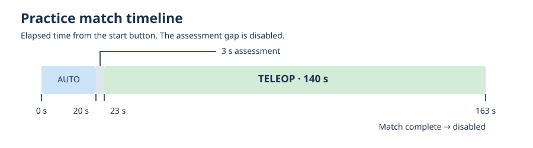

# Run a simulated practice match

The reusable controller and its interface are documented in [MecoSimulation practice mode](https://github.com/MECO-Robotics/MecoSimulation-cpp/blob/wpilib-2026/docs/practice-mode.md).

Practice mode runs a 2026 match sequence on the desktop. It supplies the Driver Station state and HUB timing used by offensive AutoDrive.

## Start a match

1. Start the simulator with `./gradlew simulateNative` and connect your controller in SimGUI.
2. In SimGUI, choose your alliance station and leave the robot **disabled**.
3. Choose an auto in the dashboard's `Auto Choices`. Desktop simulation defaults to **AutoDrive offensive**.
4. In Elastic or another SmartDashboard-compatible dashboard, click **Start Practice Match**. The button uses the SimGUI station; an unknown station falls back to Blue1. After the assessment gap, hold the pilot's **LB** to run offense during teleop.
5. Watch `/Sim/Practice/State`: `autonomous`, `assessment`, `teleop`, then `complete`.

Select the auto before starting. During a run, let practice mode control the simulated Driver Station: manually changing mode, enable, alliance, attachment, or E-stop can abort the match. Ending or aborting disables the robot.

## If it doesn't start

- Check `/Sim/Practice/LastCommandAccepted` and `/Sim/Practice/Reason`.
- `start-requires-disabled-and-no-estop` means to disable the robot and clear the simulated E-stop before trying again.
- `external-ds-change` means another Driver Station control changed during the sequence. Start a fresh match while disabled.
- If offense says `wait-for-match`, check the station and `/Match/HubKnown`. In teleop the game data must also be valid.

## Useful topics

| Topic under `/Sim/Practice/` | What it does |
| --- | --- |
| `Command` | Send a new string update: `start`, `abort`, or `reset`. |
| `Config/AllianceStation` | `Red1`–`Red3` or `Blue1`–`Blue3`; default `Blue1` for direct commands. |
| `Config/AutoResult` | `R` or `B`: the alliance whose HUB goes inactive first. Default: `R`. |
| `State`, `Running`, `RemainingSeconds` | Show the sequence and current phase countdown. |
| `LastCommandAccepted`, `Reason` | Explain whether the last command worked. |

Settings are sampled at start. The dashboard button copies SimGUI's selected station into the practice configuration. `reset` clears the session; it does not reset the robot or fuel.

## Read the code

- [Practice controller lifecycle](../src/main/cpp/Robot.cpp)
- [Start button and autonomous chooser](../src/main/cpp/RobotContainer.cpp)
- [Practice smoke test](../scripts/practice_smoke.py)
