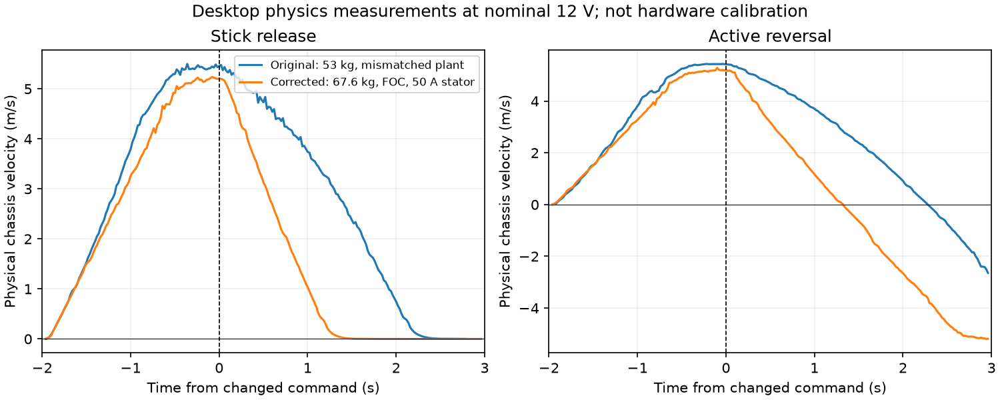

> Historical detail: this record may describe earlier versions or experiments. Start with the [current guide](../simulation-dynamics.md).

# Drivetrain acceleration and braking

Desktop simulation uses the requested maximum ready-to-drive mass **67.6 kg**
(robot, bumpers and typical battery), four Kraken X60 motors, the configured
5.890909 drive ratio and 0.0508 m wheel radius. The real robot's existing mass
configuration and gains are unchanged. Drive limits remain **50 A stator/slip**
and **55 A supply** per motor; steering remains 30 A.

## Electrical mismatch fixed

Native Phoenix swerve requests enable FOC. MecoSimulation 2026.0.8 instead left
its illustrative motor defaults in place (12/366 ohms, 7.09/366 Nm/A and
55 rad/s/V), and incorrectly used the 55 A supply setting as winding current.
The adapter now uses WPILib 2026.2.1 `DCMotor::KrakenX60FOC(1)` and the configured
50 A `slipCurrent`. SparkMax retains the NEO model and SmartCurrentLimit mapping.
The correction originated in MecoSimulation-cpp commit `7001f22` and is included
in the 2026.0.9 vendordep with matching contact-loaded physics and headers. The
robot no longer replaces the adapter archive object. The Base ABI is unchanged;
Simulation's extended DrivePhysics layout is packaged as a matched unit.

This matters especially when braking: Phoenix adjusts voltage near the motor's
back-EMF to enforce current limiting. A plant with different back-EMF constants
interprets that output as much less braking torque. The measured applied voltage
stayed positive after requesting zero speed; that is valid current-limited
braking, not proof that the requested speed remained positive.

Acceleration and deceleration are **not assigned matching slew limits**. The
plant computes signed winding current from `(V - rotorSpeed/Kv)/R`, torque from
`Kt*I`, tire force and wheel/chassis inertia. Motoring loses voltage headroom near
maximum speed; braking has different voltage headroom and control transients.
At some speeds both can reach the same stator-current ceiling, so unequal torque
at every speed is not assumed. Enabled zero-speed control, active reversal and
disabled neutral braking are measured separately.

Primary references: [CTRE stator versus supply current](https://v6.docs.ctr-electronics.com/en/stable/docs/hardware-reference/talonfx/improving-performance-with-current-limits.html),
[WCP Kraken performance](https://docs.wcproducts.com/welcome/electronics/kraken-x60/kraken-x60-motor/overview-and-features/motor-performance),
and the pinned WPILib `frc/system/plant/DCMotor.h` and Phoenix 26.1.2
`swerve/impl/SwerveModuleImpl.hpp` / `SwerveModule.hpp`.

## Measurement and regression

Run the actual desktop executable with an empty field so a wall does not become
the brake:

```sh
FRC_SIM_FIELD_COLLIDERS=0 FRC_SIM_LATENCY_PROBE=1 ./scripts/sim_headless.sh
# In another terminal, using the Python environment documented in README:
python scripts/drive_dynamics_smoke.py --output artifacts/drive-dynamics-fixed.json
```

The driver targets localhost only, resets physical truth with Back (button 7),
commands full forward for two seconds, then tests stick release, reversal and
disable for three seconds each. It disables on exit. Velocity is an 80 ms centred
difference of physical body position, not an encoder/setpoint comparison.
Subscriptions request 20 ms updates; duplicate truth timestamps are excluded.
The stop threshold is +0.1 m/s; reversal distance ends at its first forward stop.
Timing is relative to the last sampled truth before the changed command, with
approximately one loop of command/telemetry uncertainty plus differentiation.

The regression bands allow nominal-voltage/current-limit transport and tire
transients but reject the original >2 s / >7 m enabled stop. With the configured
0.01 kg m² output inertia per wheel, reflected translational inertia adds about
15.5 kg; the ideal 50 A motor-force acceleration ceiling is about 5.4 m/s².
The tuning helper's motor-force/mass acceleration is an upper bound which omits
this rotational inertia, not a measured chassis acceleration.

See `artifacts/drive-dynamics-original.json` (original plant/configuration plus
passive electrical probe) and `artifacts/drive-dynamics-fixed.json` (corrected
model/configuration) for actual binary hashes, stimuli, raw truth and metrics.
The original executable deliberately fails the new braking regression.
`/Diagnostics/Drive/MotorElectrical`, enabled only by `FRC_SIM_LATENCY_PROBE`,
contains timestamp followed by applied volts, Phoenix torque current and supply
current for each of four drive motors. It publishes at most once per 20 ms.

Measured results (physical body truth):

| Measurement | Original | Corrected |
|---|---:|---:|
| Acceleration, 0.5 to 4 m/s, release run | 0.80 s | 0.98 s |
| Release braking, 4 to 0.5 m/s | 1.16 s | 0.80 s |
| Release stop from about 5.2–5.5 m/s | 2.24 s / 7.13 m | 1.30 s / 3.32 m |
| Reversal first forward stop | 2.26 s / 7.16 m | 1.30 s / 3.42 m |
| Disabled braking stop (model approximation) | 0.98 s / 2.87 m | 0.98 s / 2.44 m |

The original and corrected runs intentionally use their respective 53 kg and
67.6 kg configurations; this is a before/after validation, not an isolated mass
sensitivity experiment. The original model fails enabled release/reversal bounds;
the corrected model passes all three modes.



## Limits of this evidence

These are desktop measurements, not hardware calibration. Battery sag and
regenerative battery charging are not modeled by this run (nominal 12 V supply).
Current desktop tire friction is user-selected 2.1 (the historical runs below
used 2.9; neither is a measured WCP-1728 coefficient). Wheel/steer inertia 0.01 kg m², yaw MOI 6.883 kg m² and body
principal-axis/CoM estimates remain unmeasured configuration assumptions. Payload
mass is not dynamically added. Disabled brake/coast and firmware protection
behavior are approximated by the voltage-driven, current-clamped plant; do not
use its disabled stopping distance as a hardware safety guarantee.

Square/circle results are retained in `artifacts/drive-dynamics-patterns.json`
and `artifacts/drive-dynamics-original-patterns.json`. Both circle checks pass.
The square has unwanted accumulated yaw above the existing 0.15 rad limit in
both versions (original 0.175 rad; corrected 0.237 rad), although velocity,
azimuth, encoder-versus-truth and estimated heading checks pass. This remains a
steering/control limitation; the dynamics fix does not claim to resolve it and
the threshold is unchanged.

## Flat-carpet tipping diagnosis

Full-stick, abrupt 90-degree square inputs reproduce severe tipping on an empty
flat field: about 70 degrees at the first corner with the configured friction
2.9. Straight full acceleration/release/reversal stays below 0.18 degrees in this
run; disabled braking peaks at 1.84 degrees. This distinguishes lateral scrub
from the current-limited straight-line acceleration/braking problem.

The simulated CoM remains **assumed 0.30 m above the floor**. That diagnosis used
a 0.30 m body origin and zero CoM offset. The [bumper model](../bumper-contact.md)
now uses a 0.0762 m body origin plus 0.2238 m relative CoM offset. It is not a measured CoM. Module
centres are 0.5588 m apart. A centred, level body's static edge-unloading threshold
is therefore `g * 0.2794 / 0.30`, approximately **9.13 m/s² (0.93 g)**. This is a
quasistatic reference, not a guarantee against transient tipping.

The 50 A motor limit does not bound sideways scrub to the motor acceleration
ceiling. Redirecting rolling wheels at speed generates lateral tire forces, capped
by friction times normal reaction. Friction 2.9 permits much larger lateral forces
than this assumed geometry can support without unloading wheels. A temporary
friction-only ablation to 1.2 still overturned at the first corner; that value also
permits lateral acceleration above the static threshold. Thus friction alone was
not established as the sole cause, and no arbitrary lower-friction fix was kept.

[MapleSim's configuration API](https://shenzhen-robotics-alliance.github.io/maple-sim/javadocs/org/ironmaple/simulation/drivesims/configs/SwerveModuleSimulationConfig.html)
gives around 1.2 as a usual starting friction value, but its
[COTS wheel references](https://github.com/Shenzhen-Robotics-Alliance/maple-sim/blob/main/project/src/main/java/org/ironmaple/simulation/drivesims/COTS.java)
include a range of tire-dependent values. They do not measure this robot's grip,
CoM or 3D tipping behavior. Roll/pitch inertia is also still the unmeasured default
4 kg m². These tests establish the simulated trigger, not realistic hardware tip
limits or the absence of contact-solver error. Correct calibration requires the
robot's ready-to-drive CoM and tire/carpet traction, rather than changing mass or
adding fictitious suspension to hide the symptom.

Compact observations are in `artifacts/tipping-diagnosis.json`. The temporary
friction change was reverted and the original production binary/field-collider
GUI restored. No production physics or control parameters changed in this diagnosis.

The numerical tables and tipping diagnosis above predate the low bumper collision shell. They are retained as historical evidence; floor contact with the new bumper can change the tipping response. See [bumper contact](../bumper-contact.md) for current geometry and checks.
