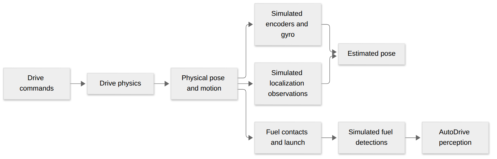
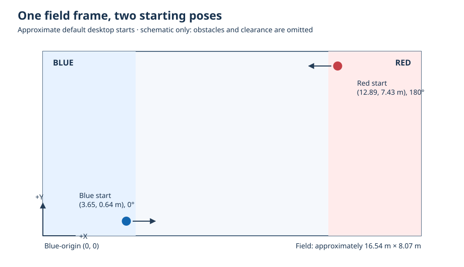

# Simulation field and fuel

## TL;DR

- The simulator approximates the field, fuel, and robot contact; use it to check behavior, not physical clearance or calibration.
- In teleop, **Back/View** resets the simulated scene; **Start** only resets driver forward.
- If a start is rejected, check `Simulation/AutoStartPose`. See [starting and resetting](#starting-and-resetting) and [troubleshooting](#troubleshooting).

The reusable physics model is documented in [MecoSimulation](https://github.com/MECO-Robotics/MecoSimulation-cpp/blob/wpilib-2026/docs/jolt-simulation.md).

The desktop simulator builds a simplified REBUILT field around the robot. REBUILT dimensions and collision bodies are season-owned in [FieldGeometry2026.h](../src/main/include/season/simulation/FieldGeometry2026.h); MecoSimulation supplies generic physics and collision helpers. The drive adapter owns the physics world; the season code chooses the starting pose and updates fuel.

[Diagram source](visuals/mermaid/simulation-data-flow.mmd)

## What is modeled?

- Walls, hubs, bump plates, trench supports and arms, and simplified towers and depots.
- Fuel as particles, including approximate field and robot contacts. Escaped fuel returns to the carpet; fuel is not a collection of Jolt rigid bodies.
- A low chassis and bumper envelope. Decorative geometry and full mechanism collisions are omitted.

The robot supplies contact construction estimates in [SimulationConfig.h](../src/main/include/season/simulation/SimulationConfig.h): a 2-inch pan clearance and a 0.5-inch flush foam and backing floor gap. The reusable [bumper contact model](https://github.com/MECO-Robotics/MecoSimulation-cpp/blob/wpilib-2026/docs/compliant-bumper-contact.md) belongs to MecoSimulation. These are simulation estimates, not physical measurements.

The scene is an approximation, not official CAD or proof of field clearance.

The fuel model and shooting trajectory checks use different dimensions: the simulated particle diameter is 5.5 inches and its HUB scoring region has a 0.6096 m half-width, while the trajectory clearance calculation uses a 5.91-inch fuel diameter and a 47-inch HUB width. These model assumptions have not been reconciled; a simulated score does not verify physical shot clearance. See [SimulationConfig.h](../src/main/include/season/simulation/SimulationConfig.h) and [Shooting.h](../src/main/include/season/shooting/Shooting.h) before changing them.

## Starting and resetting

- Default blue spawn: approximately `(3.65, 0.64 m, 0°)`; red is mirrored to approximately `(12.89, 7.43 m, 180°)`.
- A selected auto can request its initial pose. In simulation, the physical body and odometry are reset together; starts intersecting field geometry are rejected.
- `/SmartDashboard/Simulation/AutoStartPose` reports `applied`, `blocked-by-field`, or `not-requested`.
- In teleop, pilot **Back/View** resets the scene. Pilot **Start** resets driver forward, not the field pose.
- The simulator waits for feedback to settle after a reset. Physical truth, camera observations, and estimated odometry remain distinct.

## Read the code

- [Scene setup and pose resets](../src/main/cpp/season/simulation/RobotSimulationRuntime.cpp)
- [REBUILT field geometry](../src/main/include/season/simulation/FieldGeometry2026.h) and [field behavior helpers](../src/main/cpp/season/simulation/SimulationField.cpp)
- [Fuel simulation adapter](../src/main/cpp/season/simulation/FuelSimulation.cpp), [fuel model](../src/main/cpp/season/simulation/FuelModel.cpp), and [model interface](../src/main/include/season/simulation/Simulation.h)

## Troubleshooting

- If the robot will not turn, check whether it has overturned; use **Back/View** to reset the simulation scene.
- If inputs seem slow, check controller polling, robot loop timing, and AutoDrive status before changing gains. On Linux, a covered SimGUI window has previously slowed joystick polling.
- `FRC_SIM_LATENCY_PROBE=1` enables timing diagnostics. Simulation behavior is not hardware calibration.
