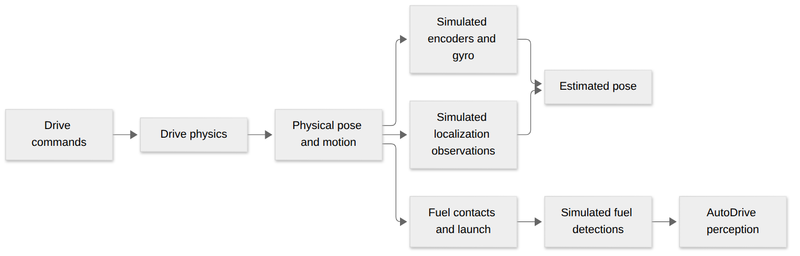
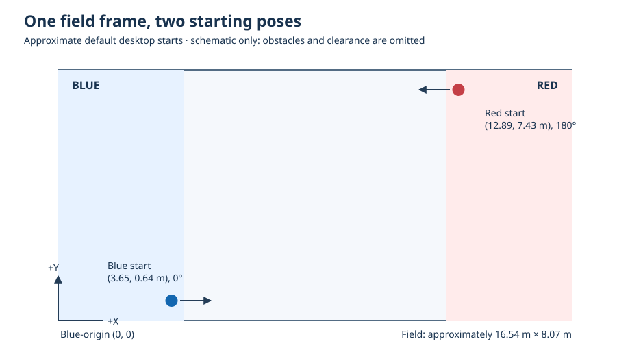

# Simulation field and fuel

The reusable physics model is documented in [MecoSimulation](https://github.com/MECO-Robotics/MecoSimulation-cpp/blob/wpilib-2026/docs/jolt-simulation.md).

The desktop simulator builds a simplified REBUILT field around the robot. The drive adapter owns the physics world; the season code chooses the starting pose and updates fuel.

[Diagram source](visuals/mermaid/simulation-data-flow.mmd)

## What is modeled?

- Walls, hubs, bump plates, trench supports and arms, and simplified towers and depots.
- Fuel as particles, including approximate field and robot contacts. Escaped fuel returns to the carpet; fuel is not a collection of Jolt rigid bodies.
- A low chassis and bumper envelope. Decorative geometry and full mechanism collisions are omitted.

The robot supplies contact construction estimates in [RobotContainer.cpp](../src/main/cpp/RobotContainer.cpp): a 2-inch pan clearance and a 0.5-inch flush foam and backing floor gap. The reusable [bumper contact model](https://github.com/MECO-Robotics/MecoSimulation-cpp/blob/wpilib-2026/docs/compliant-bumper-contact.md) belongs to MecoSimulation. These are simulation estimates, not physical measurements.

The scene is an approximation, not official CAD or proof of field clearance.

## Starting and resetting

- Default blue spawn: approximately `(3.65, 0.64 m, 0°)`; red is mirrored to approximately `(12.89, 7.43 m, 180°)`.
- A selected auto can request its initial pose. In simulation, the physical body and odometry are reset together; starts intersecting field geometry are rejected.
- `/SmartDashboard/Simulation/AutoStartPose` reports `applied`, `blocked-by-field`, or `not-requested`.
- In teleop, pilot **Back/View** resets the scene. Pilot **Start** resets driver forward, not the field pose.
- The simulator waits for feedback to settle after a reset. Physical truth, camera observations, and estimated odometry remain distinct.

## Read the code

- [Scene setup and pose resets](../src/main/cpp/RobotContainer.cpp)
- [Field helpers](../src/main/cpp/season/SimulationField.cpp)
- [Fuel simulation](../src/main/cpp/season/FuelSimulation.cpp) and [model interface](../src/main/include/season/Simulation.h)
- [Auto-start pose smoke check](../scripts/auto_start_pose_smoke.py)

## Troubleshooting

- If the robot will not turn, check whether it has overturned; use **Back/View** to reset the simulation scene.
- If inputs seem slow, check controller polling, robot loop timing, and AutoDrive status before changing gains. On Linux, a covered SimGUI window has previously slowed joystick polling.
- `FRC_SIM_LATENCY_PROBE=1` enables timing diagnostics. Simulation behavior is not hardware calibration.
