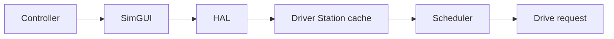

# Slow controller input in simulation

A slow-looking robot can have several causes: stale controller input, a slow robot loop, repeated path replanning, or a robot physically stuck in the simulated field. Check which signal is delayed before changing gains.

- On this Linux setup, a covered SimGUI window previously slowed physical joystick polling. The launch paths default `vblank_mode=0`; an explicitly supplied value overrides it.
- The robot publishes a simulated Driver Station packet in its simulation loop. That helps packet ingestion, but cannot make a stalled GUI poll the controller.
- AutoDrive can deliberately stop while a changed target settles and it replans. See [AutoDrive](autodrive-simulation.md).
- For timing investigation, launch with `FRC_SIM_LATENCY_PROBE=1`. The [detailed record](reference/simulation-latency.md) explains the topics, measurements, and their limits.

Read [Robot.cpp](../src/main/cpp/Robot.cpp) for the loop and [RobotContainer.cpp](../src/main/cpp/RobotContainer.cpp) for driver input. Historical measurements are not a guarantee of current performance on another computer.
