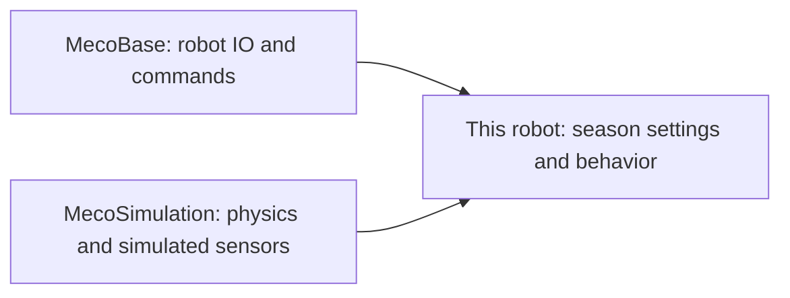

# Who owns what in simulation?

- **MecoBase:** drive, motor IO, commands, and reusable robot logic.
- **MecoSimulation:** the desktop physics world, field helpers, simulated sensors, battery, and contact models.
- **This project:** hardware configuration, controls, 2026 game rules, fuel behavior, and display telemetry.

There should be one owner for simulated drivetrain physics. Keep physical truth, sensor observations, and odometry separate. Desktop-only APIs must not be required by a roboRIO build.

- [Robot setup](../src/main/cpp/RobotContainer.cpp)
- [Fuel model](../src/main/cpp/season/FuelSimulation.cpp)
- [Pinned vendordeps](../vendordeps/)
- [Detailed ownership and release evidence](reference/simulation-vendordep-boundary.md)
